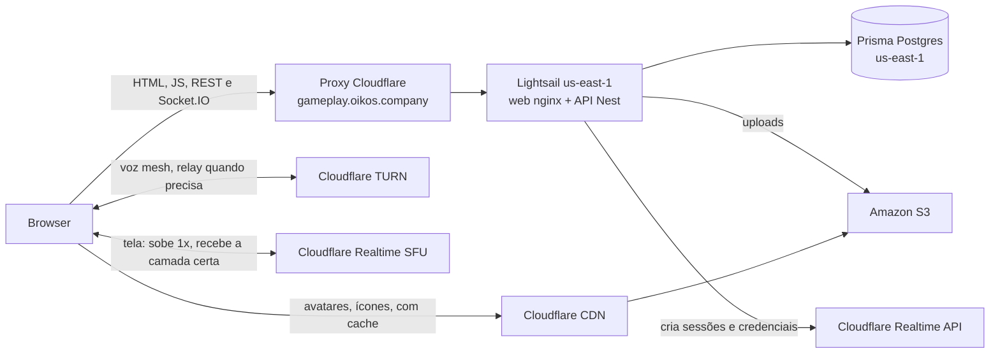

# Produção: AWS + Cloudflare + Prisma Postgres, com SFU

> Escrito em 2026-10-26. Só planejamento e precificação: nada daqui foi implementado.

## 1. Contexto

O host em casa (`infra/self-hosted`, Cloudflare Tunnel) não sustenta transmissão para mais de um espectador. Em mesh, quem transmite codifica e sobe uma cópia para cada espectador; no teste com dois, a imagem caiu para 408p e 30 fps instável. Transformar o PC em SFU não resolve: o upload da casa passaria a mandar as N cópias, e o túnel da Cloudflare não passa UDP.

Decisões do usuário em 2026-10-26:
- Servidor na **AWS**, demais serviços na **Cloudflare**.
- Banco no **Prisma Postgres** (Postgres gerenciado pela Prisma). O volume de dados atual cabe com folga.
- **SFU é requisito** para manter a qualidade das transmissões.
- Compartilhar janelas e jogos com áudio isolado fica para um **app desktop (Electron)**, depois. O browser não captura áudio por processo.

## 2. Decisões de arquitetura

| Peça | Escolha | Por quê |
|---|---|---|
| Região | **us-east-1** | Pergunta do usuário. A mídia (voz e live) passa pela Cloudflare, que é anycast e atende pelo PoP de São Paulo; os ~120 ms a mais só afetam API e socket (login, entrar na sala, eventos), não o áudio e o vídeo. Custa cerca de metade de São Paulo. O banco precisa ficar na mesma região da API. |
| API e web | **Amazon Lightsail, 2 GB** | Preço fixo com IPv4 e 3 TB de tráfego inclusos. Docker com a API (Nest + sharp) e o web (nginx com o build do Vite), como no self-hosted. EC2 sairia mais caro somando IPv4, disco e egress. |
| Banco | **Prisma Postgres, plano Starter** | Escolha do usuário. Starter tem backup de 7 dias e 1M de operações. O Free (200 mil operações/mês, sem backup) serve para começar, mas o Better Auth consulta a sessão a cada requisição e pode estourar. |
| Web | **No Lightsail, mesma origem da API** | Decisão do usuário em 2026-10-27, no lugar do Cloudflare Workers: o web é leve, e com a mesma origem não precisa de CORS, `VITE_API_URL` nem cookie entre subdomínios. Os arquivos em `/assets/` têm hash e `Cache-Control: immutable`, então o proxy da Cloudflare faz o cache na borda do mesmo jeito. |
| Uploads | **Amazon S3 (us-east-1)** | Decisão do usuário: nada de arquivo na máquina, que fica para processamento. O driver `s3` da API já existe. A API acessa com a chave de um usuário IAM restrito ao bucket (o Lightsail não usa papéis IAM). As imagens são servidas por um domínio da Cloudflare com cache, para não pagar a saída do S3. |
| Voz | **Mesh + TURN da Cloudflare** | Como hoje. Voz é leve (~50 kbps por pessoa). |
| Tela | **Cloudflare Realtime SFU com simulcast** | Quem transmite sobe uma vez; a Cloudflare entrega a cada espectador a camada que a rede dele aguenta. |
| DNS, TLS, proxy | **Cloudflare Free** | Proxy laranja no domínio do app (TLS, WebSocket, proteção DDoS). O Lightsail aceita conexões só dos IPs da Cloudflare. |
| Observabilidade | **Grafana Cloud e Sentry (planos grátis)** | Como já configurado no OBS-01 a OBS-06. |

Domínio: web e API em `gameplay.oikos.company` (decisão do usuário em 2026-10-27; antes a API ficaria em `unlimited.oikos.company` e o web no Workers). Tem um nível só, então o SSL Universal grátis da Cloudflare cobre; um nome como `api.gameplay.oikos.company` exigiria o Advanced Certificate Manager, pago.

## 3. Diagrama

## 4. Tráfego do SFU

Cenário do usuário (grupo pequeno): live quase todo dia à noite por até 2 h; no fim de semana mais longa (estimei 4 h); 2 a 3 espectadores.

- Por espectador: 5 Mbps em média = 2,25 GB/h. No teto do 1080p60 (8 Mbps) = 3,6 GB/h.
- O upload de quem transmite para a Cloudflare não é cobrado. Só a saída da Cloudflare para os espectadores.
- Mês: 22 dias × 2 h × 3 + 8 dias × 4 h × 3 = **228 horas-espectador**.

| Cenário | Conta | GB/mês | Custo |
|---|---|---|---|
| Grupo pequeno, médio | 228 h × 2,25 GB | ~510 | 0 (dentro da franquia) |
| Grupo pequeno, pessimista | 228 h × 3,6 GB | ~820 | 0 (dentro da franquia) |
| Comunidade média (~50 pessoas, live diária de 3 h, 4 a 5 espectadores) | 405 h × 2,25 a 3,6 GB | ~910 a 1.460 | 0 a ~US$ 23 |

Franquia: 1.000 GB/mês grátis, **compartilhada entre SFU e TURN**, depois US$ 0,05/GB. O tráfego que passa pelos dois não é cobrado em dobro. Voz via TURN é desprezível.

## 5. Custo mensal (us-east-1)

| Item | Serviço | US$/mês |
|---|---|---|
| API + web | Lightsail 2 GB (2 vCPU, 60 GB SSD, 3 TB, IPv4) | 12,00 |
| Snapshot automático do disco | Lightsail | ~1 a 3 |
| Banco | Prisma Postgres Starter | 10,00 (0 no Free) |
| Uploads | Amazon S3, atrás do cache da Cloudflare | menos de 1 |
| SFU + TURN | Cloudflare Realtime | 0 (até 1.000 GB) |
| DNS, proxy, TLS | Cloudflare Free | 0 |
| Erros e métricas | Sentry e Grafana Cloud Free | 0 |
| **Total, grupo pequeno** | | **~23 a 26** |
| Comunidade média | Lightsail 4 GB (US$ 24), Prisma Pro se passar de 1M operações (US$ 49), SFU acima da franquia | ~50 a 100 |

Para comparação, o mesmo desenho com EC2 t4g.small (~US$ 12) + IPv4 (US$ 3,65) + disco + egress fica em ~US$ 18 só de servidor; com RDS db.t4g.micro no lugar do Prisma, mais ~US$ 12 a 15. Em São Paulo os preços da AWS ficam perto do dobro.

**Os preços vêm de buscas feitas em outubro de 2026, a maioria em sites de terceiros (Lightsail, Prisma, S3).** Conferir cada um na página oficial antes de assinar.

## 6. O que muda no código para produção (não implementado)

- **Mesma origem:** com o web no Lightsail (2026-10-27), `BETTER_AUTH_URL` e `WEB_ORIGIN` são o mesmo `APP_URL`, e o código do web não muda. Sem CORS, `VITE_API_URL` nem cookie entre subdomínios.
- **Uploads:** `STORAGE_DRIVER=s3` com `S3_BUCKET`, `S3_REGION=us-east-1` e a chave IAM; `PUBLIC_UPLOADS_URL` absoluto, no domínio da Cloudflare que faz cache do bucket.
- **IP real:** com o proxy da Cloudflare, ler `CF-Connecting-IP` e ajustar `TRUST_PROXY_HOPS`; `X-Forwarded-Proto` no nginx.
- **Banco:** `DATABASE_URL` do Prisma Postgres; conferir a conexão TCP direta com o adapter `pg` do Prisma 7; `prisma migrate deploy` no deploy.
- **Deploy:** scripts rodados desta máquina, sem pipeline no GitHub (ver seção 7).
- **Telemetria:** `OTEL_*`, `VITE_SENTRY_DSN` e o coletor do Faro de produção; os túneis `/monitoring/sentry` e `/monitoring/faro` continuam no nginx, como no self-hosted (o Brave bloqueia o sentry.io).

## 7. Deploy pela máquina local

Decisão do usuário em 2026-10-26: enquanto o projeto é pequeno, tudo sai desta máquina, sem registry de imagens nem pipeline no GitHub. O build acontece aqui, e a imagem pronta vai para o servidor pela internet. O Lightsail não constrói nada: a CPU dele fica para a API.

**Infra:** `terraform apply` daqui, com as credenciais da AWS e da Cloudflare nesta máquina.

**API** (`npm run deploy:api`, a escrever):
1. Recusa se não estiver na `main` ou se houver mudança sem commit; roda typecheck, lint e testes.
2. Constrói as imagens da API e da migração com a tag do SHA do commit. A plataforma é a do Lightsail (x86; conferir no plano escolhido).
3. Manda as imagens por SSH: `docker save | gzip | ssh … docker load`.
4. No servidor: roda a migração (`prisma migrate deploy`) num container que sai ao terminar, sobe a API nova com `docker compose up -d --wait` e volta para a tag anterior se o healthcheck falhar.
5. Cria uma tag no git (`deploy-api-<data>`) para registrar o que foi publicado.

**Web**: vai no mesmo deploy, como a imagem `gameplay-web` (nginx com o build do Vite e os source maps enviados ao Sentry no build), com a mesma tag da API. Os dois sobem juntos, então o web nunca fala com uma API de outra versão. Compose e nginx em `infra/production/`.

**Acesso SSH** (decisão do usuário em 2026-10-26): porta 22 liberada só para o IPv4 desta casa (`TF_VAR_ssh_allowed_cidr`, /32). Produção não usa Cloudflare Tunnel; o túnel é só do `infra/self-hosted`. Se a operadora trocar o IP, atualizar a variável e rodar `terraform apply`.

**Otimizar as imagens** (pedido do usuário; hoje API 651 MB e migração 2,42 GB):
- Migração: estágio próprio só com o Prisma CLI, o schema, as migrações e o seed compilado, em vez de reaproveitar o estágio de build com o monorepo inteiro.
- API: medir o `node_modules` do `runner` (`du`) e cortar o que não roda em produção; avaliar uma base menor (por exemplo distroless para Node) mantendo o `sharp` com musl ou glibc compatível.
- Ordem das camadas: dependências antes do código, para que um deploy que muda só o código reaproveite as camadas de baixo no build.
- Envio: o `docker save` manda a imagem inteira a cada deploy. Se o tamanho incomodar depois da otimização, avaliar uma ferramenta que mande só as camadas novas por SSH, ou um registry.

**Quando mudar:** se outra pessoa passar a fazer deploy, ou se quisermos testes automáticos em cada PR, os mesmos scripts viram passos do GitHub Actions.

## 8. Credenciais

Levantamento de 2026-10-26. Nenhuma credencial foi criada ainda. Estado desta máquina: Terraform 1.16.2, `wrangler` 4.123 logado por OAuth na conta da Cloudflare (`20e7e533453b2614035e3d6cb0f11941`), Prisma CLI 7.10.1 no repositório (`npx prisma`), `gh` logado. Falta o AWS CLI.

**A. Para o Terraform rodar daqui**

| Credencial | Onde criar | Permissões |
|---|---|---|
| Usuário IAM `gameplay-terraform` com chave de acesso (perfil `gameplay` no `aws configure`) | Console da AWS, com MFA no usuário root e alerta de orçamento ligado antes | Lightsail, S3 e IAM (criar o bucket e o usuário da aplicação). Nunca a chave do root. |
| Token de API da Cloudflare `gameplay-terraform` | Painel da Cloudflare, token customizado, só na zona `oikos.company` | Zone DNS (edit), Zone Settings (edit, modo SSL), SSL and Certificates (edit, Origin CA), Workers Scripts e Workers Routes (edit, domínio do web). Sem Tunnel nem Access: produção não usa túnel. |
| ID da conta e ID da zona `oikos.company` | Painel da Cloudflare | Entram como variáveis, não são segredo |
| Chave SSH ed25519 (`~/.ssh/gameplay-lightsail`) | Esta máquina (`ssh-keygen`) | A pública vai para o Lightsail pelo Terraform |
| IPv4 desta casa | `curl -4 ifconfig.me` | Libera a porta 22 só para ele (/32) |

**B. Criadas à mão**

| Credencial | Onde | Observação |
|---|---|---|
| Banco no Prisma Postgres (us-east-1, Starter) | Prisma Console | O CLI do Prisma 7 não cria banco de produção (só `postgres link` e o banco local do `prisma dev`). Copiar a `DATABASE_URL` de conexão direta. |
| TURN da Cloudflare | Já existe (`CLOUDFLARE_TURN_KEY_ID` e `CLOUDFLARE_TURN_API_TOKEN` no `.env` do host) | Reaproveitar ou criar uma chave só de produção |
| App do Realtime SFU (ID e token) | Painel da Cloudflare, Realtime | Só nos tickets SFU |

**C. Geradas pelo Terraform (outputs para o `.env` do servidor)**

IP estático do Lightsail, nome do bucket, chave de acesso do usuário IAM da aplicação (só no bucket), certificado e chave de origem da Cloudflare para o nginx.

**D. Segredos da aplicação**

- `BETTER_AUTH_SECRET` e `REGISTRATION_KEY_SECRET`: **se os dados do host forem migrados, manter os mesmos valores do `.env` do host.** O Better Auth usa o segredo para os dados de sessão e de 2FA, e as chaves de cadastro são assinadas com o outro; trocar invalida as sessões, o 2FA e as chaves não usadas.
- `ADMIN_EMAIL`, `ADMIN_USERNAME` e `ADMIN_PASSWORD` para o seed, se o banco começar vazio.

**E. Observabilidade (já existem no host, conferir para produção)**

`OTEL_EXPORTER_OTLP_ENDPOINT` e `OTEL_EXPORTER_OTLP_HEADERS` (Grafana Cloud), `VITE_SENTRY_DSN`, `SENTRY_AUTH_TOKEN`, `SENTRY_ORG` e `SENTRY_PROJECT`, e a URL do coletor do Faro. Sem o nginx na frente do web, o web fala direto com o Sentry e o Faro (sem os túneis `/monitoring/*`).

**F. Onde cada uma fica**

- Esta máquina: chave do IAM `gameplay-terraform` (perfil do AWS CLI), token da Cloudflare (variável `CLOUDFLARE_API_TOKEN`), login do `wrangler`, chave SSH, `terraform.tfstate` (fora do git, com backup) e o `.env` de produção usado pelo deploy.
- Servidor: `.env` da API, com permissão 600, e o certificado de origem.
- Nenhuma no git.

## 9. Certificados

- **Browser → Cloudflare:** SSL Universal da Cloudflare, grátis e renovado sozinho, para `oikos.company` e `*.oikos.company` (um nível de subdomínio). Cobre `gameplay.oikos.company` e o domínio das imagens, se for de um nível.
- **Cloudflare → Lightsail:** certificado de origem da Cloudflare (Origin CA, grátis, até 15 anos) instalado no nginx, com a zona em modo **Full (strict)**. Hoje o túnel faz esse papel; na AWS ele sai. O firewall do Lightsail aceita só os IPs da Cloudflare.
- **TURN, SFU e Prisma Postgres:** certificados dos próprios serviços, sem nada a configurar.

## 10. SFU

O desenho detalhado já está em `plans/media-transport-options.md`; aqui ele deixa de ser fase opcional e vira requisito:
- O módulo `ice` da API vira `media`: credenciais do TURN, criação de sessões e tracks do SFU pela API da Cloudflare (o token fica só no servidor) e controle de orçamento.
- No web, um `SfuTransport` só para a tela. A voz continua no `MeshTransport`.
- Quem transmite publica com simulcast (por exemplo 1080p60, 720p30, 360p15); cada espectador assina e recebe a camada da sua rede.
- Orçamento mensal de GB no módulo `limits`, abaixo da franquia; ao chegar no limite, transmissões novas voltam para mesh.
- Desenho fechado em 2026-10-27 (`media-transport-options.md`, seção 7): SFU por padrão, mesh como opção ao compartilhar, sem modo automático.

## 11. Riscos

- **Franquia compartilhada:** SFU e TURN somam na mesma franquia de 1.000 GB. O orçamento no `limits` evita surpresa.
- **Operações do Prisma:** no Free, 200 mil operações/mês podem não bastar por causa da sessão consultada a cada requisição. Começar no Starter ou ativar o cache de cookie de sessão do Better Auth.
- **Instância única:** presença e estado das salas ficam em memória. Um deploy derruba todo mundo por alguns segundos, e eles reconectam. Redis e mais de uma instância continuam para depois.
- **Região do Prisma Postgres:** confirmar que existe em us-east-1. Se não existir, escolher a região da AWS mais próxima da que ele oferece.
- **Lightsail:** CPU com crédito (burstable). O `sharp` processando muitas imagens de uma vez pode gastar os créditos; para o tamanho atual é suficiente.

## 12. Tickets propostos (só a lista, nada executado)

| Ticket | Escopo |
|---|---|
| INF-01 | Conta AWS, Lightsail em us-east-1, firewall só com IPs da Cloudflare, DNS, proxy e certificado de origem |
| INF-02 | Prisma Postgres, `DATABASE_URL`, migração dos dados do host |
| INF-03 | Bucket S3, usuário IAM restrito, domínio com cache na Cloudflare e `STORAGE_DRIVER=s3` |
| INF-04 | ~~Web no Workers, CORS e cookies entre web e API~~. Cancelado em 2026-10-27: web no Lightsail, mesma origem da API |
| INF-05 | Script de deploy desta máquina (API e web juntos), e imagens da API e da migração otimizadas |
| SFU-01 | Módulo `media` na API: sessões e tracks do Cloudflare Realtime SFU |
| SFU-02 | Transmissão pelo SFU no web com simulcast, mesh como opção no diálogo |
| SFU-03 | Orçamento mensal no `limits` e qualidade escolhida por quem assiste |
| SFU-04 | Aba Mídia no admin: SFU, Mesh e TURN globais e por servidor |
| SFU-05 | Aviso da plataforma para os usuários |
| DESK-01 | Estudo do app desktop em Electron (captura de áudio por processo). Plano em `08-desktop-electron.md`, com DESK-02 a DESK-10 |

## 13. Antes de assinar, conferir na página oficial

- Preço do Lightsail 2 GB e 4 GB em us-east-1.
- Prisma Postgres: preço, operações incluídas, regiões e conexão direta com o adapter `pg`.
- Cloudflare Realtime (SFU e TURN) e Amazon S3 (armazenamento, operações e saída).

## Fontes

- [Cloudflare Realtime SFU pricing](https://developers.cloudflare.com/realtime/sfu/pricing)
- [Cloudflare TURN FAQ](https://developers.cloudflare.com/realtime/turn/faq/)
- [Amazon Lightsail pricing 2026 (cloudburn)](https://cloudburn.io/blog/amazon-lightsail-pricing)
- [Lightsail em São Paulo, anúncio de junho de 2026](https://aws.amazon.com/pt/about-aws/whats-new/2026/06/amazon-lightsail-aws-regions/)
- [EC2 t4g.small (vantage)](https://instances.vantage.sh/aws/ec2/t4g.small)
- [RDS db.t4g.micro (bytebase)](https://www.bytebase.com/dbcost/rds/instance/db.t4g.micro/)
- [Cobrança de IPv4 pública na AWS (vantage)](https://www.vantage.sh/blog/aws-public-ipv4-cost-and-how-to-see)
- [Egress de São Paulo](https://aws.amazon.com/blogs/aws/aws-data-transfer-out-dto-40-price-reduction-in-south-america-sao-paulo-region)
- [Prisma Postgres](https://www.prisma.io/postgres)
- [Prisma Postgres vs Neon, preços 2026](https://www.prisma.io/blog/prisma-postgres-vs-neon-pricing-2026)
- [Cloudflare Workers pricing](https://developers.cloudflare.com/workers/platform/pricing/index.md)
