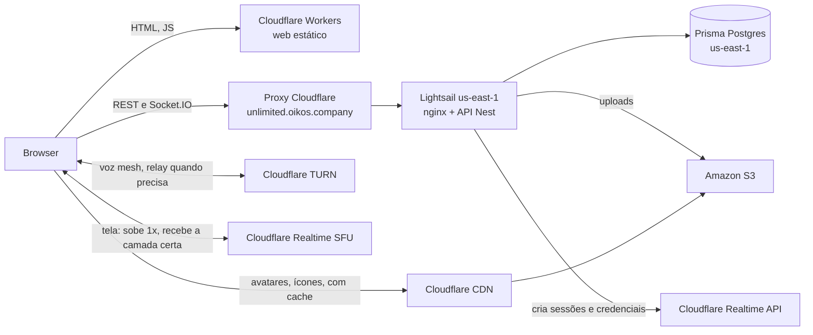

# Produção: AWS + Cloudflare + Prisma Postgres, com SFU

> Escrito em 2026-10-26. Só planejamento e precificação: nada daqui foi implementado.

## 1. Contexto

O host em casa (`infra/host`, Cloudflare Tunnel) não sustenta transmissão para mais de um espectador. Em mesh, quem transmite codifica e sobe uma cópia para cada espectador; no teste com dois, a imagem caiu para 408p e 30 fps instável. Transformar o PC em SFU não resolve: o upload da casa passaria a mandar as N cópias, e o túnel da Cloudflare não passa UDP.

Decisões do usuário em 2026-10-26:
- Servidor na **AWS**, demais serviços na **Cloudflare**.
- Banco no **Prisma Postgres** (Postgres gerenciado pela Prisma). O volume de dados atual cabe com folga.
- **SFU é requisito** para manter a qualidade das transmissões.
- Compartilhar janelas e jogos com áudio isolado fica para um **app desktop (Electron)**, depois. O browser não captura áudio por processo.

## 2. Decisões de arquitetura

| Peça | Escolha | Por quê |
|---|---|---|
| Região | **us-east-1** | Pergunta do usuário. A mídia (voz e live) passa pela Cloudflare, que é anycast e atende pelo PoP de São Paulo; os ~120 ms a mais só afetam API e socket (login, entrar na sala, eventos), não o áudio e o vídeo. Custa cerca de metade de São Paulo. O banco precisa ficar na mesma região da API. |
| API | **Amazon Lightsail, 2 GB** | Preço fixo com IPv4 e 3 TB de tráfego inclusos. Docker com a API (Nest + sharp) e o nginx, como no host. EC2 sairia mais caro somando IPv4, disco e egress. |
| Banco | **Prisma Postgres, plano Starter** | Escolha do usuário. Starter tem backup de 7 dias e 1M de operações. O Free (200 mil operações/mês, sem backup) serve para começar, mas o Better Auth consulta a sessão a cada requisição e pode estourar. |
| Web | **Cloudflare Workers (static assets)** | Arquivos estáticos grátis e sem limite de requisições. Substitui a ideia antiga do Netlify. |
| Uploads | **Amazon S3 (us-east-1)** | Decisão do usuário: nada de arquivo na máquina, que fica para processamento. O driver `s3` da API já existe. A API acessa com a chave de um usuário IAM restrito ao bucket (o Lightsail não usa papéis IAM). As imagens são servidas por um domínio da Cloudflare com cache, para não pagar a saída do S3. |
| Voz | **Mesh + TURN da Cloudflare** | Como hoje. Voz é leve (~50 kbps por pessoa). |
| Tela | **Cloudflare Realtime SFU com simulcast** | Quem transmite sobe uma vez; a Cloudflare entrega a cada espectador a camada que a rede dele aguenta. |
| DNS, TLS, proxy | **Cloudflare Free** | Proxy laranja na API (TLS, WebSocket, proteção DDoS). O Lightsail aceita conexões só dos IPs da Cloudflare. |
| Observabilidade | **Grafana Cloud e Sentry (planos grátis)** | Como já configurado no OBS-01 a OBS-06. |

Domínios: web em `gameplay.oikos.company`, API em `unlimited.oikos.company` (decisão do usuário). Os dois têm um nível só, então o SSL Universal grátis da Cloudflare cobre ambos; um nome como `api.gameplay.oikos.company` exigiria o Advanced Certificate Manager, pago. São o mesmo site (`oikos.company`), então o cookie de sessão do Better Auth, que fica na API, vai junto nas chamadas do web.

## 3. Diagrama

## 4. Tráfego do SFU

Cenário do usuário (grupo pequeno): live quase todo dia à noite por até 2 h; no fim de semana mais longa (estimei 4 h); 2 a 3 espectadores.

- Por espectador: 5 Mbps em média = 2,25 GB/h. No teto do 1080p60 (8 Mbps) = 3,6 GB/h.
- O upload de quem transmite para a Cloudflare não é cobrado. Só a saída da Cloudflare para os espectadores.
- Mês: 22 dias × 2 h × 3 + 8 dias × 4 h × 3 = **228 horas-espectador**.

| Cenário | Conta | GB/mês | Custo |
|---|---|---|---|
| Grupo pequeno, médio | 228 h × 2,25 GB | ~510 | 0 (dentro da franquia) |
| Grupo pequeno, pessimista | 228 h × 3,6 GB | ~820 | 0 (dentro da franquia) |
| Comunidade média (~50 pessoas, live diária de 3 h, 4 a 5 espectadores) | 405 h × 2,25 a 3,6 GB | ~910 a 1.460 | 0 a ~US$ 23 |

Franquia: 1.000 GB/mês grátis, **compartilhada entre SFU e TURN**, depois US$ 0,05/GB. O tráfego que passa pelos dois não é cobrado em dobro. Voz via TURN é desprezível.

## 5. Custo mensal (us-east-1)

| Item | Serviço | US$/mês |
|---|---|---|
| API + nginx | Lightsail 2 GB (2 vCPU, 60 GB SSD, 3 TB, IPv4) | 12,00 |
| Snapshot automático do disco | Lightsail | ~1 a 3 |
| Banco | Prisma Postgres Starter | 10,00 (0 no Free) |
| Web estático | Cloudflare Workers | 0 |
| Uploads | Amazon S3, atrás do cache da Cloudflare | menos de 1 |
| SFU + TURN | Cloudflare Realtime | 0 (até 1.000 GB) |
| DNS, proxy, TLS | Cloudflare Free | 0 |
| Erros e métricas | Sentry e Grafana Cloud Free | 0 |
| **Total, grupo pequeno** | | **~24 a 26** |
| Comunidade média | Lightsail 4 GB (US$ 24), Prisma Pro se passar de 1M operações (US$ 49), SFU acima da franquia | ~50 a 100 |

Para comparação, o mesmo desenho com EC2 t4g.small (~US$ 12) + IPv4 (US$ 3,65) + disco + egress fica em ~US$ 18 só de servidor; com RDS db.t4g.micro no lugar do Prisma, mais ~US$ 12 a 15. Em São Paulo os preços da AWS ficam perto do dobro.

**Os preços vêm de buscas feitas em outubro de 2026, a maioria em sites de terceiros (Lightsail, Prisma, R2).** Conferir cada um na página oficial antes de assinar.

## 6. O que muda no código para produção (não implementado)

- **Origens separadas:** `BETTER_AUTH_URL` aponta para a API e `WEB_ORIGIN` para o web; CORS com credenciais no REST e no Socket.IO; cookie do Better Auth no domínio `oikos.company`.
- **Web:** `VITE_API_URL` e o Socket.IO conectando direto na API (hoje é mesma origem via nginx); build publicado no Workers com fallback de SPA para `index.html`.
- **Uploads:** `STORAGE_DRIVER=s3` com `S3_BUCKET`, `S3_REGION=us-east-1` e a chave IAM; `PUBLIC_UPLOADS_URL` absoluto, no domínio da Cloudflare que faz cache do bucket.
- **IP real:** com o proxy da Cloudflare, ler `CF-Connecting-IP` e ajustar `TRUST_PROXY_HOPS`; `X-Forwarded-Proto` no nginx.
- **Banco:** `DATABASE_URL` do Prisma Postgres; conferir a conexão TCP direta com o adapter `pg` do Prisma 7; `prisma migrate deploy` no deploy.
- **Deploy:** CI (ainda não existe `.github/workflows`) que roda typecheck, lint e testes, constrói a imagem da API, publica no Lightsail e publica o web no Workers.
- **Telemetria:** `OTEL_*`, `VITE_SENTRY_DSN` e `VITE_FARO_URL` de produção; os túneis `/monitoring/*` do nginx do host deixam de ser necessários se o web falar direto com os coletores.

## 7. Certificados

- **Browser → Cloudflare:** SSL Universal da Cloudflare, grátis e renovado sozinho, para `oikos.company` e `*.oikos.company` (um nível de subdomínio). Cobre `gameplay.oikos.company`, `unlimited.oikos.company` e o domínio das imagens, se for de um nível.
- **Cloudflare → Lightsail:** certificado de origem da Cloudflare (Origin CA, grátis, até 15 anos) instalado no nginx, com a zona em modo **Full (strict)**. Hoje o túnel faz esse papel; na AWS ele sai. O firewall do Lightsail aceita só os IPs da Cloudflare.
- **Web no Workers, TURN, SFU e Prisma Postgres:** certificados dos próprios serviços, sem nada a configurar.

## 8. SFU

O desenho detalhado já está em `plans/media-transport-options.md`; aqui ele deixa de ser fase opcional e vira requisito:
- O módulo `ice` da API vira `media`: credenciais do TURN, criação de sessões e tracks do SFU pela API da Cloudflare (o token fica só no servidor) e controle de orçamento.
- No web, um `SfuTransport` só para a tela. A voz continua no `MeshTransport`.
- Quem transmite publica com simulcast (por exemplo 1080p60, 720p30, 360p15); cada espectador assina e recebe a camada da sua rede.
- Orçamento mensal de GB no módulo `limits`, abaixo da franquia; ao chegar no limite, transmissões novas voltam para mesh.
- Decisões ainda em aberto no `media-transport-options.md`, seção 6: modo automático ou sempre SFU, limite de espectadores para trocar, e o seletor de qualidade do espectador.

## 9. Riscos

- **Franquia compartilhada:** SFU e TURN somam na mesma franquia de 1.000 GB. O orçamento no `limits` evita surpresa.
- **Operações do Prisma:** no Free, 200 mil operações/mês podem não bastar por causa da sessão consultada a cada requisição. Começar no Starter ou ativar o cache de cookie de sessão do Better Auth.
- **Instância única:** presença e estado das salas ficam em memória. Um deploy derruba todo mundo por alguns segundos, e eles reconectam. Redis e mais de uma instância continuam para depois.
- **Região do Prisma Postgres:** confirmar que existe em us-east-1. Se não existir, escolher a região da AWS mais próxima da que ele oferece.
- **Lightsail:** CPU com crédito (burstable). O `sharp` processando muitas imagens de uma vez pode gastar os créditos; para o tamanho atual é suficiente.

## 10. Tickets propostos (só a lista, nada executado)

| Ticket | Escopo |
|---|---|
| INF-01 | Conta AWS, Lightsail em us-east-1, firewall só com IPs da Cloudflare, DNS, proxy e certificado de origem |
| INF-02 | Prisma Postgres, `DATABASE_URL`, migração dos dados do host |
| INF-03 | Bucket S3, usuário IAM restrito, domínio com cache na Cloudflare e `STORAGE_DRIVER=s3` |
| INF-04 | Web no Workers, `VITE_API_URL`, CORS e cookies entre web e API |
| INF-05 | CI/CD: testes, imagem da API, deploy no Lightsail e no Workers |
| SFU-01 | Módulo `media` na API: sessões e tracks do Cloudflare Realtime SFU |
| SFU-02 | `SfuTransport` no web com simulcast, troca de camada pelo espectador |
| SFU-03 | Orçamento mensal no `limits` e troca entre mesh e SFU |
| DESK-01 | Estudo do app desktop em Electron (captura de áudio por processo) |

## 11. Antes de assinar, conferir na página oficial

- Preço do Lightsail 2 GB e 4 GB em us-east-1.
- Prisma Postgres: preço, operações incluídas, regiões e conexão direta com o adapter `pg`.
- Cloudflare Realtime (SFU e TURN) e Amazon S3 (armazenamento, operações e saída).

## Fontes

- [Cloudflare Realtime SFU pricing](https://developers.cloudflare.com/realtime/sfu/pricing)
- [Cloudflare TURN FAQ](https://developers.cloudflare.com/realtime/turn/faq/)
- [Amazon Lightsail pricing 2026 (cloudburn)](https://cloudburn.io/blog/amazon-lightsail-pricing)
- [Lightsail em São Paulo, anúncio de junho de 2026](https://aws.amazon.com/pt/about-aws/whats-new/2026/06/amazon-lightsail-aws-regions/)
- [EC2 t4g.small (vantage)](https://instances.vantage.sh/aws/ec2/t4g.small)
- [RDS db.t4g.micro (bytebase)](https://www.bytebase.com/dbcost/rds/instance/db.t4g.micro/)
- [Cobrança de IPv4 pública na AWS (vantage)](https://www.vantage.sh/blog/aws-public-ipv4-cost-and-how-to-see)
- [Egress de São Paulo](https://aws.amazon.com/blogs/aws/aws-data-transfer-out-dto-40-price-reduction-in-south-america-sao-paulo-region)
- [Prisma Postgres](https://www.prisma.io/postgres)
- [Prisma Postgres vs Neon, preços 2026](https://www.prisma.io/blog/prisma-postgres-vs-neon-pricing-2026)
- [Cloudflare Workers pricing](https://developers.cloudflare.com/workers/platform/pricing/index.md)
