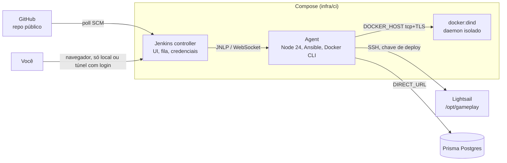

# Pipeline self-hosted: Jenkins + Ansible

> Escrito em 2026-10-27. Só planejamento: nada daqui foi implementado. O deploy de produção continua pelo `npm run deploy` até este plano ser executado.

## 1. Contexto e objetivo

O primeiro deploy de produção (2026-10-27) saiu desta máquina pelo `infra/production/deploy.sh`: build aqui, envio por SSH, migração pelo `DIRECT_URL`, rollback para o release anterior e seed do admin. Funciona, mas depende desta máquina, dos segredos dela e de quem roda o comando.

Objetivo do usuário: **aprender o processo de deploy por dentro** (pipeline, agents, credenciais, chaves, aprovação, rollback) montando uma estrutura self-hosted, em containers, com ferramentas que o mercado pede. Não é uma necessidade de escala do projeto; o ganho para o Gameplay vem de tirar o deploy desta máquina e deixá-lo registrado.

Decisões do usuário nas conversas de 2026-10-26 e 2026-10-27:
- Self-hosted e **em containers**, nunca rodando direto nesta máquina.
- **Jenkins** como orquestrador (aparece nas vagas). Sem Kubernetes no começo.
- A lógica do deploy sai do shell solto para uma ferramenta própria. Candidata: **Ansible**. Será estudado com calma antes de implementar.

## 2. Papéis de cada ferramenta

| Camada | Ferramenta | Faz | Já existe |
|---|---|---|---|
| Infra | Terraform (`infra/terraform`) | Cria Lightsail, IP, firewall, S3, IAM, DNS, certificado de origem | Sim |
| Configuração do servidor | Ansible (`provision.yml`) | Docker, swap, upgrade, pasta `/opt/gameplay`, certificado de origem | Hoje é o `bootstrap.sh` + comandos à mão |
| Deploy | Ansible (`deploy.yml`) | Envia as imagens, escreve `.env`, compose e nginx, migra, sobe, rollback, seed | Hoje é o `deploy.sh` |
| Orquestração | Jenkins (`Jenkinsfile`) | Quando roda, onde roda, segredos, logs, aprovação manual, histórico | Não |
| Checks | npm (`typecheck`, `lint`, `test`) | Igual hoje | Sim |

Regra: a lógica fica no Ansible e nos scripts do npm, que também rodam localmente. O `Jenkinsfile` só encadeia as etapas e entrega as credenciais. Trocar o Jenkins pelo GitHub Actions depois não muda o deploy.

## 3. Arquitetura do Jenkins



- **Sem Kubernetes.** O Jenkins é uma aplicação Java; roda num container. Kubernetes só entra se quisermos agents como pods descartáveis (fase opcional, seção 8).
- **Controller** sem executores próprios: tudo roda no agent.
- **Docker-in-Docker** (`docker:dind`) em vez de montar o `/var/run/docker.sock` desta máquina: o socket do host equivale a root nela.
- **Agent** com imagem própria (`infra/ci/agent.Dockerfile`): Node 24, Ansible, Docker CLI, `openssh-client`, `git`.
- Volumes nomeados para o `JENKINS_HOME` (configuração, credenciais, histórico). Fazer backup dele, como do `terraform.tfstate`.
- Configuração como código com o plugin **Configuration as Code** (`jenkins.yaml`) e lista de plugins fixa (`plugins.txt`), para recriar o Jenkins do zero sem cliques.

## 4. Acesso e gatilhos

- O Jenkins **não fica exposto na internet**. Acesso pela porta em `127.0.0.1`, ou de fora por Cloudflare Tunnel com Cloudflare Access (login antes de chegar no Jenkins).
- Repositório público: **PR de fork nunca roda no Jenkins**. Ele tem a chave de produção.
- Gatilho: **poll SCM** da `main` (a cada poucos minutos), porque o webhook do GitHub precisaria alcançar o Jenkins pela internet. Webhook pelo túnel fica como exercício depois.
- Deploy de produção sempre com **aprovação manual** (`input`) depois dos checks e do build.

## 5. Chaves e credenciais

Ponto central do estudo. Cada credencial com dono, escopo mínimo e lugar certo.

| Credencial | Hoje | No pipeline |
|---|---|---|
| Chave SSH do servidor | `~/.ssh/gameplay-lightsail`, a mesma das pessoas | **Chave nova só do Jenkins** (`gameplay-ci`), ed25519, no Credentials Store do Jenkins. A pública entra no servidor pelo Ansible. A chave pessoal continua para acesso de emergência |
| Host key do servidor | `known_hosts` desta máquina | Fixada no Jenkins (`known_hosts` como credencial ou arquivo do agent). Nunca `StrictHostKeyChecking=no` |
| `DIRECT_URL` (migração) | `infra/production/.env` | Credencial do Jenkins (secret text) |
| Segredos da API (`BETTER_AUTH_SECRET`, chave do S3, TURN, OTEL) | `infra/production/.env` | **Ansible Vault** no repositório (arquivo cifrado), com a senha do vault como credencial do Jenkins. Alternativa: um secret file por ambiente no Jenkins |
| `SENTRY_AUTH_TOKEN` | `.env` | Credencial do Jenkins, entra como build secret no `docker build` |
| Senha do admin (seed) | `.env` | Só no vault; o seed roda uma vez, não a cada deploy |
| Credenciais da AWS e da Cloudflare (Terraform) | `infra/terraform/.env` | **Ficam fora do Jenkins.** Infra continua manual por `terraform apply`; o pipeline só publica a aplicação |

Regras:
- Segredo nunca em log: `withCredentials` mascara; nada de `set -x` em passo com segredo.
- Nada de segredo em linha de comando no servidor (o `ps` mostra). Já é assim no `deploy.sh`.
- Rotação: documentar como trocar cada uma (chave SSH, tokens). Rodar a rotação uma vez como exercício.
- Revogação: se o Jenkins vazar, remover a pública `gameplay-ci` do servidor e trocar `DIRECT_URL` e tokens.

## 6. Fluxo do pipeline

```
checkout -> npm ci -> [typecheck | lint | test] em paralelo
         -> build gameplay-api e gameplay-web (tag = commit)
         -> aprovação manual "Publicar em produção?"
         -> ansible-playbook deploy.yml
              envia imagens (docker save | gzip | docker load)
              escreve .env (do vault), compose e nginx
              prisma migrate deploy (DIRECT_URL)
              docker compose up -d --wait
              falhou: volta para o RELEASE anterior e falha o build
         -> confere https://gameplay.oikos.company/api/health
         -> tag deploy-AAAAMMDD-HHMM e push da tag
post: aviso de sucesso ou falha (Discord, opcional)
```

- Rollback manual também como job: parâmetro `RELEASE`, só sobe uma imagem que ainda está no servidor (hoje ficam a atual e a anterior).
- Imagens continuam sem registry, como hoje. Registry (GHCR) fica para quando o envio por SSH incomodar ou se o Kamal entrar.

## 7. Fases

| Fase | Entrega | Aprende |
|---|---|---|
| CI-01 | Jenkins em Compose (`infra/ci`): controller, agent e dind, com CasC e `plugins.txt`. Só local | Arquitetura controller e agent, plugins, dind |
| CI-02 | Pipeline de checks na `main` (poll SCM): `npm ci`, typecheck, lint, testes em paralelo | Jenkinsfile declarativo, `parallel`, `post` |
| CI-03 | Ansible: `provision.yml` substitui o `bootstrap.sh` e os passos à mão (Docker, swap, upgrade, certificado, chave `gameplay-ci`). Roda desta máquina primeiro | Inventário, playbooks, idempotência, roles |
| CI-04 | Ansible: `deploy.yml` substitui o `deploy.sh`, com segredos no Ansible Vault. Roda desta máquina primeiro | Vault, handlers, rollback |
| CI-05 | Jenkins publica: build, aprovação manual, `ansible-playbook deploy.yml` com as credenciais do Jenkins, job de rollback | Credentials Store, `withCredentials`, `input` |
| CI-06 | Acesso de fora por Cloudflare Tunnel + Access, e webhook do GitHub pelo túnel | Exposição segura, webhooks |
| CI-07 | Exercício de rotação e revogação das credenciais (seção 5) | Ciclo de vida de chaves |

Ordem pensada para cada fase funcionar sozinha. O `deploy.sh` só sai do repositório depois do CI-05 rodar em produção pelo menos uma vez.

## 8. Opcional, depois

- **Agents no Kubernetes**: cluster local com `kind` ou `k3d` e o plugin Kubernetes, um pod por build.
- **Comparar com GitHub Actions**: o mesmo fluxo em `.github/workflows`, chamando o mesmo `ansible-playbook`. Em repositório público os runners do GitHub são grátis.
- **Kamal** como alternativa ao Ansible para o deploy (exige registry).
- **Dagger** para escrever o pipeline em TypeScript.

## 9. Riscos

- O Jenkins concentra a chave de produção: se ficar exposto ou com plugin desatualizado, vira porta de entrada. Mitigação: sem exposição pública, plugins fixos e atualizados, chave só do CI e revogável.
- Esta máquina continua sendo o host do Jenkins: se ela estiver desligada, não há deploy. Aceitável para estudo; o `npm run deploy` continua como plano B até o CI-05.
- Migração rodando antes de trocar os containers exige migrações compatíveis com o release anterior (adicionar, nunca remover ou renomear no mesmo deploy). Vale igual para o script e para o pipeline.

## 10. Pendências relacionadas (fora deste plano)

- Proteção da documentação da API (`/api/docs`) em produção: opções levantadas em 2026-10-27 (sessão de admin, `DOCS_ENABLED=false`, basic auth, Cloudflare Access). Aguarda decisão do usuário.
- E-mail do admin de produção (hoje `admin@gameplay.local`), `sslmode=verify-full` no `DATABASE_URL`, backup do `terraform.tfstate`, push da tag `deploy-20261027-0239`, PR da `feature/production-infra`.
