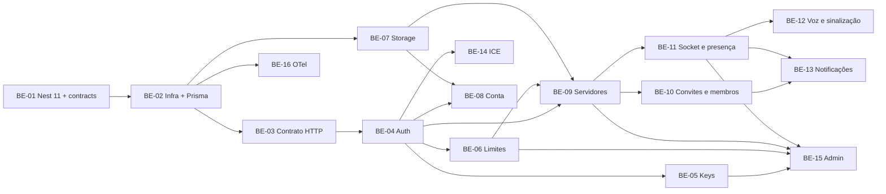
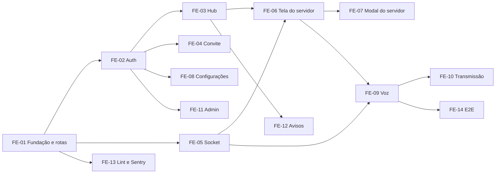

# Tickets

Um arquivo por ticket, cada um com contexto, escopo, fora do escopo, referências, checklist e critério de aceite. Backend (BE): base `plans/04-tech-plan.md`. Frontend (FE): base `plans/05-web-plan.md`.

## Backend

Como trabalhar:
- Todos os tickets do backend são feitos na branch `feature/api-setup`, sem branch por ticket (decisão do usuário em 2026-10-24).
- Commit a cada passo verde.
- Ao terminar, marque o checklist e atualize o status abaixo.

| Ticket | Pontos | Onda | Status |
|---|---|---|---|
| [BE-01 Nest 11 e `packages/contracts`](BE-01-fundacao-nest11-shared.md) | 5 | 1 | concluído |
| [BE-02 Postgres, env, Prisma 7, logs, e2e](BE-02-infra-env-prisma.md) | 5 | 2 | concluído |
| [BE-03 Erros, zod, OpenAPI, AsyncAPI, eventos](BE-03-plataforma-http-contrato.md) | 5 | 3 | concluído |
| [BE-07 Storage e imagens](BE-07-storage-e-imagens.md) | 5 | 3 | concluído |
| [BE-16 OpenTelemetry](BE-16-observabilidade.md) | 3 | 3 | concluído |
| [BE-04 Better Auth](BE-04-auth-better-auth.md) | 8 | 4 | concluído |
| [BE-05 Keys de cadastro](BE-05-keys-de-cadastro.md) | 5 | 5 | concluído |
| [BE-06 Limites e configurações](BE-06-limites-e-configuracoes.md) | 3 | 5 | concluído |
| [BE-08 Conta e hardware](BE-08-contas.md) | 5 | 5 | concluído |
| [BE-14 ICE e IP](BE-14-ice-e-ip.md) | 3 | 5 | concluído |
| [BE-09 Servidores e salas](BE-09-servidores-e-salas.md) | 8 | 6 | concluído |
| [BE-10 Convites e membros](BE-10-convites-e-membros.md) | 8 | 7 | concluído |
| [BE-11 Socket: conexão e presença](BE-11-realtime-presenca.md) | 8 | 7 | concluído |
| [BE-12 Salas de voz e sinalização](BE-12-salas-de-voz-e-sinalizacao.md) | 8 | 8 | concluído |
| [BE-13 Notificações](BE-13-notificacoes.md) | 3 | 8 | concluído |
| [BE-15 Admin da plataforma](BE-15-admin-da-plataforma.md) | 8 | 8 | concluído |
| [BE-17 Lacunas para o web](BE-17-lacunas-para-o-web.md) | 5 | 9 | concluído |

Total: 90 pontos. Tickets da mesma onda podem rodar em paralelo.

## Frontend

Base: `plans/05-web-plan.md`. Branch `feature/web-routing`. Commit a cada passo verde e parada para review ao fim de cada ticket.

| Ticket | Pontos | Onda | Status |
|---|---|---|---|
| [FE-01 Ferramentas e rotas em `src/app/`](FE-01-fundacao-e-rotas.md) | 5 | 1 | concluído |
| [FE-02 SignIn, 2FA, SignUp, sair](FE-02-auth.md) | 5 | 2 | concluído |
| [FE-05 Socket, presença e remoções](FE-05-socket-e-presenca.md) | 5 | 2 | concluído |
| [FE-13 Lint MVVM e Sentry](FE-13-boundaries-e-sentry.md) | 3 | 2 | concluído |
| [FE-03 Hub, criar servidor, notificações](FE-03-hub.md) | 5 | 3 | concluído |
| [FE-04 Convite de servidor](FE-04-convite-de-servidor.md) | 3 | 3 | concluído |
| [FE-08 Configurações e hardware](FE-08-configuracoes.md) | 5 | 3 | concluído |
| [FE-11 Painel admin](FE-11-admin.md) | 8 | 3 | concluído |
| [FE-06 Tela do servidor](FE-06-tela-do-servidor.md) | 5 | 4 | concluído |
| [FE-12 Avisos do ambiente e favicon](FE-12-avisos-do-ambiente.md) | 3 | 4 | concluído |
| [FE-07 Modal do servidor](FE-07-modal-do-servidor.md) | 8 | 5 | concluído |
| [FE-09 Salas de voz](FE-09-voz.md) | 8 | 5 | concluído |
| [FE-10 Compartilhar e assistir tela](FE-10-transmissao.md) | 8 | 6 | concluído |
| [FE-14a E2E com Cypress, fluxos atuais](FE-14-e2e-cypress.md) | 3 | 5 | concluído |
| [FE-14b E2E de voz e transmissão com peer bot](FE-14-e2e-cypress.md) | 3 | 6 | concluído |
| [FE-15 Áudio da transmissão e qualidade para quem assiste](FE-15-audio-e-qualidade-da-transmissao.md) | 5 | 7 | concluído |
| [FE-16 Player imersivo da live e tela cheia no celular](FE-16-player-imersivo.md) | 5 | 7 | concluído |

Total: 86 pontos.

## Observabilidade

Base: BE-16 e FE-13. Branch `feature/observability`. Decisão do usuário em 2026-10-26: Sentry só para erros do web, Grafana Cloud para API e realtime, Faro para desempenho, traces do browser e qualidade de mídia.

| Ticket | Pontos | Onda | Status |
|---|---|---|---|
| [OBS-01 Grafana Cloud no host](OBS-01-grafana-no-host.md) | 2 | 1 | concluído |
| [OBS-02 Sentry para erros do web](OBS-02-sentry-erros.md) | 3 | 1 | concluído (falta conferir um erro no Sentry) |
| [OBS-03 Métricas e logs do realtime na API](OBS-03-realtime-na-api.md) | 5 | 2 | concluído |
| [OBS-04 Grafana Faro no web](OBS-04-faro.md) | 5 | 2 | concluído (falta conferir uma call real) |
| [OBS-05 Dashboards e alertas](OBS-05-dashboards-e-alertas.md) | 3 | 3 | em andamento (falta canal de notificação e synthetic check) |
| [OBS-06 Health detalhado](OBS-06-health-detalhado.md) | 3 | 1 | concluído |

Total: 21 pontos.

## SFU

Base: `plans/media-transport-options.md` seção 7 e `plans/06-producao-aws.md` seção 10. Branch `feature/sfu`, saída da `dev`. Decisão do usuário em 2026-10-27: a tela vai pelo Cloudflare Realtime SFU por padrão, com o mesh como opção no diálogo de compartilhar. A voz continua em mesh.

| Ticket | Pontos | Onda | Status |
|---|---|---|---|
| [SFU-01 Módulo `media` na API](SFU-01-modulo-media-na-api.md) | 8 | 1 | pendente |
| [SFU-04 Modos permitidos na plataforma e por servidor](SFU-04-modos-permitidos.md) | 5 | 2 | pendente |
| [SFU-02 Transmissão pelo SFU no web](SFU-02-transmissao-pelo-sfu-no-web.md) | 8 | 3 | pendente |
| [SFU-03 Orçamento e qualidade de quem assiste](SFU-03-orcamento-e-qualidade.md) | 5 | 4 | pendente |

Total: 26 pontos.
