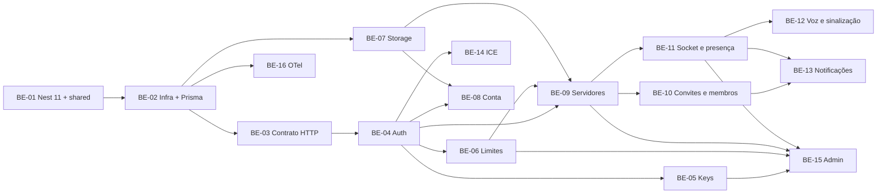

# Tickets do backend

Um arquivo por ticket, cada um com contexto, escopo, fora do escopo, referências, checklist e critério de aceite. Base: `plans/04-tech-plan.md`.

Como trabalhar:
- Todos os tickets do backend são feitos na branch `feature/api-setup`, sem branch por ticket (decisão do usuário em 2026-10-24).
- Commit a cada passo verde.
- Ao terminar, marque o checklist e atualize o status abaixo.

| Ticket | Pontos | Onda | Status |
|---|---|---|---|
| [BE-01 Nest 11 e `packages/shared`](BE-01-fundacao-nest11-shared.md) | 5 | 1 | concluído |
| [BE-02 Postgres, env, Prisma 7, logs, e2e](BE-02-infra-env-prisma.md) | 5 | 2 | concluído |
| [BE-03 Erros, zod, OpenAPI, AsyncAPI, eventos](BE-03-plataforma-http-contrato.md) | 5 | 3 | concluído |
| [BE-07 Storage e imagens](BE-07-storage-e-imagens.md) | 5 | 3 | concluído |
| [BE-16 OpenTelemetry](BE-16-observabilidade.md) | 3 | 3 | pendente |
| [BE-04 Better Auth](BE-04-auth-better-auth.md) | 8 | 4 | concluído |
| [BE-05 Keys de cadastro](BE-05-keys-de-cadastro.md) | 5 | 5 | concluído |
| [BE-06 Limites e configurações](BE-06-limites-e-configuracoes.md) | 3 | 5 | concluído |
| [BE-08 Conta e hardware](BE-08-contas.md) | 5 | 5 | concluído |
| [BE-14 ICE e IP](BE-14-ice-e-ip.md) | 3 | 5 | concluído |
| [BE-09 Servidores e salas](BE-09-servidores-e-salas.md) | 8 | 6 | concluído |
| [BE-10 Convites e membros](BE-10-convites-e-membros.md) | 8 | 7 | concluído |
| [BE-11 Socket: conexão e presença](BE-11-realtime-presenca.md) | 8 | 7 | pendente |
| [BE-12 Salas de voz e sinalização](BE-12-salas-de-voz-e-sinalizacao.md) | 8 | 8 | pendente |
| [BE-13 Notificações](BE-13-notificacoes.md) | 3 | 8 | pendente |
| [BE-15 Admin da plataforma](BE-15-admin-da-plataforma.md) | 8 | 8 | pendente |

Total: 90 pontos. Tickets da mesma onda podem rodar em paralelo.

